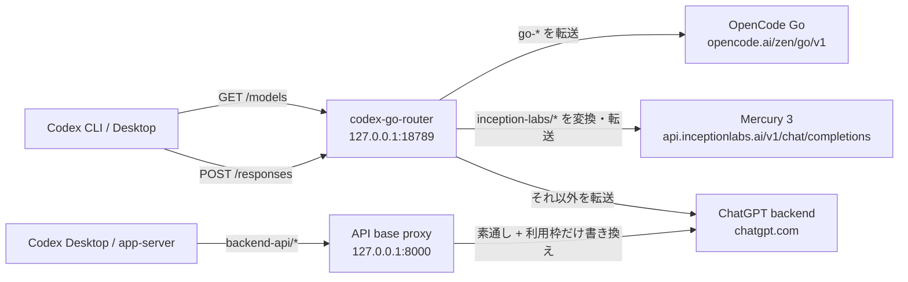

# codex-opencode-router

Codex のモデル一覧に ChatGPT、OpenCode Go、Inception Labs の Mercury 3、Claude Agent SDK、自分で設定した Responses API 互換プロバイダのモデルを同時に出すためのローカル中継サーバーです。あわせて、ChatGPT の利用枠が上限に達していても Codex Desktop の送信ボタンが無効化されないように、バックエンド API の中継（利用枠レスポンスの書き換え）も行います。

- `GET /models` … ChatGPT のモデルカタログを取得し、登録済みプロバイダのモデルを追記して返す
- `POST /responses` … モデル名の `go-`・`inception-labs/`・`claude/`・設定した `<プロバイダ ID>-` 接頭辞で接続先を選び、それ以外は ChatGPT へ転送する
- ChatGPT API ベース（`127.0.0.1:8000`）… Codex Desktop / Codex app-server のバックエンド呼び出しを中継し、利用枠（`/api/codex/usage` と `/wham/usage`）の応答だけを「制限なし」に書き換える。それ以外はそのまま `https://chatgpt.com` へ素通しする

Codex 側は `model_provider = "local-router"` を向け、デスクトップアプリには環境変数 `CODEX_API_BASE_URL=http://localhost:8000/backend-api` を渡すだけで、通常の GPT モデルと OpenCode Go のモデルを同じモデル一覧から選べます。OpenCode Go のモデルは ChatGPT の利用枠を消費しないため、ChatGPT 側の枠が尽きていても送信できます。



## AI エージェントにセットアップさせる

AI エージェント（Codex など）に任せる場合は、次のように伝えるだけで動きます。

> https://github.com/mattyatea/codex-opencode-router のセットアップをして

実行手順は [AGENTS.md](AGENTS.md) に定義しています。AI はこの README と AGENTS.md に従って、ビルド、常駐化、`~/.codex/config.toml` の設定、検証まで行います。AGENTS.md を直接読ませたい場合は https://raw.githubusercontent.com/mattyatea/codex-opencode-router/main/AGENTS.md を使ってください。

## 手動セットアップ（Linux の例）

```sh
git clone https://github.com/mattyatea/codex-opencode-router.git ~/.codex/codex-go-router
cd ~/.codex/codex-go-router
go build -o ~/.codex/bin/codex-go-router ./src

# API キー（Codex 本体と同じ .env を読む）
umask 077
printf 'export OPENCODE_GO_API_KEY=%s\n' "$OPENCODE_GO_API_KEY" >> ~/.codex/.env

mkdir -p ~/.config/systemd/user
cp deploy/codex-go-router.service ~/.config/systemd/user/
systemctl --user daemon-reload
systemctl --user enable --now codex-go-router.service
systemctl --user status codex-go-router.service
```

macOS では `~/Library/LaunchAgents/com.codex.go-router.plist` を作り、`ProgramArguments` に `/Users/<you>/.codex/bin/codex-go-router` を指定して `launchctl bootstrap gui/$(id -u) <plist>` します（`RunAtLoad` / `KeepAlive` を有効にし、ログは `~/.codex/codex-go-router.log` へ）。

## `~/.codex/config.toml` に追加する設定

```toml
model_provider = "local-router"
model_reasoning_summary = "auto"

[model_providers.local-router]
name = "Local router"
base_url = "http://127.0.0.1:18789"
requires_openai_auth = true
wire_api = "responses"
supports_websockets = false
```

### Gmail・Slack などの接続アプリが読み込まれない場合

ログに `codex_apps` の `timed out awaiting tools/list after 30s` が出る場合は、接続アプリの起動待ち時間を延ばします。
`~/.codex/config.toml` に次を追加し、Codex を再起動してください。
既存の `[mcp_servers.codex_apps]` がある場合は重複追加せず、その設定を確認して調整してください。

```toml
[mcp_servers.codex_apps]
url = "https://chatgpt.com/backend-api/ps/mcp"
auth = "chatgpt"
startup_timeout_sec = 120
http_headers = { "X-OpenAI-Product-Sku" = "codex" }
```

接続アプリは ChatGPT の認証で直接接続し、モデルの転送は引き続きルーターが担当します。
API キーの追加は不要です。
`codex mcp list --json` で `codex_apps` の待ち時間が120秒になっていることを確認し、app-server の `mcpServerStatus/list` で Gmail・Slack のツールが読み込まれたことを確認してください。
上流の利用制限や通信エラーは、待ち時間を延ばしても解消しません。

## デスクトップアプリの API ベースをローカルへ向ける

Codex Desktop は環境変数 `CODEX_API_BASE_URL` を見てバックエンドの接続先を決めます。`/backend-api` まで含めて指定してください。

**macOS**

```sh
launchctl setenv CODEX_API_BASE_URL "http://localhost:8000/backend-api"
```

再ログイン後も維持するには `~/Library/LaunchAgents/com.codex.go-router-env.plist` を作り、`/bin/launchctl setenv CODEX_API_BASE_URL http://localhost:8000/backend-api` を `RunAtLoad` で実行します（`deploy/` に雛形があります）。

**Linux**

デスクトップエントリやシェルの起動処理で `export CODEX_API_BASE_URL=http://localhost:8000/backend-api` を設定します。

設定後に Codex Desktop を再起動すると、利用枠の取得が `127.0.0.1:8000` 経由になり、枠が上限でも送信ボタンがグレーアウトしなくなります。実際の GPT モデルはこれまで通り上流の 429 を返し、アプリが `Go/...` モデルへ自動フォールバックします。

## 動作確認

```sh
codex debug models        # go-* のモデルが一覧に出る
codex exec --model go-gpt-6-luna 'Reply with OK only.'
codex exec --model go-deepseek-v4.1-flash 'How much is 17*23? Think briefly.'

# 利用枠の中継が動いているか（Codex Desktop 起動後にログへ出る）
grep -E "wham/usage|api/codex/usage" ~/.codex/codex-go-router.log
```

## 設定

| 変数 | 既定値 | 説明 |
| --- | --- | --- |
| `OPENCODE_GO_API_KEY` | なし | 設定すると組み込みの OpenCode Go モデルを有効化。`~/.codex/.env`、無ければプロセス環境変数から読む |
| `INCEPTION_API_KEY` | なし | 設定すると `inception-labs/mercury-3` を有効化。`.env` をプロセス環境変数より優先 |
| `CLAUDE_AGENT_NODE` | なし | Node.js の絶対パス。設定時だけ SDK から取得した Claude の正式モデル一覧を有効化 |
| `CLAUDE_AGENT_SDK_DIR` | なし | `npm ci` で Agent SDK をインストールしたディレクトリ（`node_modules` の親）。`CLAUDE_AGENT_NODE` を設定したときは必須 |
| `ROUTER_CONFIG` | `$CODEX_HOME/router.json` | 追加プロバイダの JSON 設定。省略時にファイルがなければ追加なし |
| `ROUTER_LISTEN` | `127.0.0.1:18789` | モデル中継の待ち受けアドレス |
| `ROUTER_API_LISTEN` | `127.0.0.1:8000,[::1]:8000` | ChatGPT API 中継の待ち受けアドレス（カンマ区切り） |
| `CODEX_HOME` | `~/.codex` | `.env` と `router.json` を探すディレクトリ |

## Mercury 3 を使う

[Inception Labs のダッシュボード](https://platform.inceptionlabs.ai/dashboard/api-keys)で取得した API キーを、`~/.codex/.env` に次の形式で保存します（パーミッションは `0600`）。ルーターのプロセス環境変数でも指定できます。

```sh
export INCEPTION_API_KEY=...
```

ルーターを再起動すると `inception-labs/mercury-3` がモデル一覧に追加されます。`router.json` への登録は不要で、キーが未設定なら無効です。利用例:

```sh
codex exec --model inception-labs/mercury-3 'Reply with OK only.'
```

Mercury 3 は [公式仕様](https://docs.inceptionlabs.ai/get-started/models)でコンテキスト 1M・テキスト入力対応です。Inception の Chat Completions API と Codex の Responses API の間で、テキスト、関数ツール、`apply_patch` などのカスタムツール、JSON / SSE 応答、使用トークン数を変換します。画像入力や上流が実行する検索ツールには対応していません。reasoning effort は `minimal` を `instant`、`xhigh` / `max` を `high` に変換します。

## Claude のサブスクを Agent SDK 経由で使う

TypeScript 版 Claude Agent SDK を使う、個人のローカル利用向け接続です。Claude のツール呼び出しは Codex に返し、実行と承認は Codex が担当します。SDK 側の組み込みツールは無効にし、Codex から渡された関数ツールと `apply_patch` などのカスタムツールだけを MCP ツールとして提示します。実行前の SDK フックで呼び出しを保留するため、SDK が別途コマンドやファイル編集を実行することはありません。

Node.js 18 以上を用意して、リポジトリの `package.json` に固定したバージョンの SDK をインストールします。SDK の Node ブリッジは Go バイナリに埋め込まれますが、Node と SDK は実行時にも必要です。Claude Code の CLI は SDK のプラットフォーム別パッケージに同梱されています。

```sh
cd ~/.codex/codex-go-router
npm ci
```

認証情報は SDK / Claude Code 自身が読み込みます。ルーターにトークンをコピーする必要はありません。この接続ではプロセスに設定された Anthropic API キーや別 API 接続先の環境変数を引き継ぎません。認証方法・利用条件の詳細は [Agent SDK](https://code.claude.com/docs/en/agent-sdk/overview) と [Claude Code の認証に関する条件](https://code.claude.com/docs/en/legal-and-compliance#authentication-and-credential-use)を参照してください。

`~/.codex/.env` に次の二行を追加します。Node のパスは `command -v node` の結果（mise などのバージョン管理ツールを使っている場合はその実体のパス）に、`/home/your-user` は自分のホームディレクトリに置き換え、ファイルのパーミッションは `0600` にしてください。systemd のサービスはシェルの `PATH` を引き継がないので、Node は絶対パスで指定します。

```sh
export CLAUDE_AGENT_NODE=/usr/bin/node
export CLAUDE_AGENT_SDK_DIR=/home/your-user/.codex/codex-go-router
```

ビルド後、ルーターと同じ端末・OS ユーザーでサブスクのアカウントへログインします。SDK 同梱の Claude Code が認証を担当します。Mac のアプリから Linux のルーターへ接続する場合も、ログインコマンドは Linux 側で実行してください。

```sh
go build -o ~/.codex/bin/codex-go-router ./src
~/.codex/bin/codex-go-router claude login
~/.codex/bin/codex-go-router claude status
```

ログイン後はそのまま再試行できます。認証情報を読むためだけにルーターを再起動する必要はありません。

ビルドしてルーターを再起動すると、SDK が返す正式モデル ID と対応する名前が一覧に追加されます。たとえば `claude/claude-sonnet-5-5` は「CC/Sonnet 5.5」と表示され、送信先にもその正式 ID を使います。利用可能なモデルと reasoning effort は起動時の SDK 情報に従い、固定の別名一覧にはしません。モデル一覧を更新するにはルーターを再起動してください。旧モデルの Haiku 4.5、Sonnet 5、Opus 5、Fable 5、Opus 4.8 / 4.7、Sonnet 4.6 は一覧から除外します。Opus 4.6 は SDK の一覧にあれば表示します。

```sh
go build -o ~/.codex/bin/codex-go-router ./src
systemctl --user restart codex-go-router.service  # Linux の場合
codex debug models
codex exec --model claude/claude-sonnet-5-5 'Reply with OK only.'
```

テキスト入力、ツール呼び出し、JSON / SSE 応答に対応します。Codex の `Thread-Id`（なければ `Session-Id`）と正式モデル ID ごとに SDK セッションを分離し、次のリクエストでは保存済みセッションを再開して追加分だけを送ります。ツール結果は SDK のネイティブな `tool_result` として渡します。Node / SDK プロセス自体はリクエストごとに起動しますが、会話履歴は SDK 側に残り、ルーターを再起動しても継続できます。

対応する SDK セッション ID と履歴照合用ハッシュは `$CODEX_HOME/claude-agent-sessions/`（既定は `~/.codex/claude-agent-sessions/`）に保存します。会話本文は Claude Code 標準のセッション保存先に残ります。同じ会話・モデルの更新はルーター側のファイルロックで直列化します。Codex での履歴の巻き戻し・圧縮、システム指示の変更、他モデルの応答の挿入、失敗・キャンセル後は保存済み履歴との対応を破棄し、Codex の履歴から新しいセッションを作ります。SDK の MCP 名ではなく Codex の元の名前でツール呼び出しが返った場合も、SDK が記録する未知ツールのエラーを再利用しないよう、次のターンは Codex の履歴から作り直します。その初回だけ、既存の assistant / tool 履歴は JSON の会話記録として渡し、画像は別の画像ブロックとして添付します。会話識別ヘッダーがないクライアントは永続化せず、毎回独立したセッションになります。

コンテキストの有効上限・最大上限・自動圧縮の閾値は、起動時に各モデルの SDK `getContextUsage()` から取得します。`CLAUDE_CODE_DISABLE_1M_CONTEXT` など SDK の環境設定も反映されます。Codex 自身の安全マージンと圧縮制御も適用されるため、Claude Code と圧縮のタイミングが一致するとは限りません。要求された最大出力は SDK に渡し、モデルの出力上限への制限は Claude Code に任せます。

画像添付とツール結果内の画像は Claude の画像ブロックとして渡します（PNG/JPEG/GIF/WebP の base64 data URL または HTTPS URL）。モデル切り替え時の履歴も画像を保持します。ツール名は SDK の MCP 名と、一意に特定できる Codex の元の名前に対応します。

OpenAI サーバー側の検索・画像生成ツール、構造化出力、`previous_response_id` による継続には対応していません。

変換とツール実行境界のテストは次で実行できます。サブスクへの実接続は上の `codex exec` で別途確認してください。

```sh
go test ./...
npm test
```

## 好きなプロバイダを追加する

Responses API（`POST /responses`）互換の接続先を、`~/.codex/router.json` に追加できます。コードの変更や再ビルドは不要です。[設定例](deploy/router.example.json) をコピーし、URL とモデル ID を使いたい接続先に置き換えてください。

```json
{
  "providers": [
    {
      "id": "myprovider",
      "name": "My Provider",
      "base_url": "https://api.example.com/v1",
      "api_key_env": "MY_PROVIDER_API_KEY",
      "models": [
        {
          "id": "model-id",
          "name": "My Provider / Model",
          "context_window": 128000,
          "clear_tool_mode": true
        }
      ]
    }
  ]
}
```

この例では `myprovider-model-id` がモデル一覧に出て、送信時は `https://api.example.com/v1/responses` に `model: "model-id"` として転送されます。`base_url` に `/responses` は含めません。`providers` には複数の接続先を、`models` には複数のモデルを指定できます。

API キーの値は JSON に書かず、`api_key_env` で指定した名前を `~/.codex/.env` に `export MY_PROVIDER_API_KEY=...` の形で保存するか、ルーターのプロセス環境変数に設定します。`.env` を使う場合はパーミッションを `0600` にしてください。認証は `Authorization: Bearer <キー>` 形式で、認証不要のローカルサーバーでは `api_key_env` を省略できます。ChatGPT の認証情報や Cookie は追加先へ転送しません。

`id` は英小文字から始まる英小文字・数字・アンダースコアで指定し、重複させないでください。`go`・`inception-labs`・`claude` は組み込みプロバイダ用の予約名です。`name` を省略すると ID を表示名に使います。モデルの `context_window` と `max_context_window` を省略すると ChatGPT のカタログの値を継承するため、使うモデルの実際の値を指定してください。`clear_tool_mode: true` は継承元の ChatGPT 専用ツールモードを解除します。

設定後はルーターを再起動します（Linux の例: `systemctl --user restart codex-go-router.service`）。OpenCode Go は従来どおり `OPENCODE_GO_API_KEY` があれば有効になり、追加プロバイダだけを使う場合は不要です。モデル一覧の取得には引き続き ChatGPT ログインが必要です。

対応範囲は Responses API 互換のリクエスト、JSON 応答、SSE ストリーミングです。Chat Completions 専用や Anthropic Messages API の接続先には、Responses API に変換する中継が別途必要です。OpenCode Go 向けのツールスキーマ・reasoning 調整は追加先には適用しません。追加先の reasoning は接続先の識別情報を付けて保持し、同じ接続先に戻すときだけ元の形へ復元します。

## 対応モデル

組み込みの OpenCode Go モデルは `src/provider/opencode.go` の `goModels` に定義しています。OpenCode Go 側で Responses API に対応しているモデルだけを載せてください（chat/completions 専用のモデルは `/responses` では 503 になります）。

| モデル ID | Codex での表示名 | コンテキスト | 備考 |
| --- | --- | --- | --- |
| `deepseek-v4.1-flash` | `Go/DeepSeek V4.1 Flash` | 1M | 生の reasoning を思考サマリーに変換して表示 |
| `gpt-6-luna` | `Go/GPT-6 Luna` | 1M | ネイティブの reasoning summary に対応 |
| `muse-spark-1.3-contributor` | `Go/Muse Spark 1.3 (Train)` | 1M | ワークスペースの Privacy 設定で学習許可が必要。function ツールのみ対応で reasoning effort は無視される（ルーターが調整） |

カタログを合成するとき、各モデルの `context_window` / `max_context_window` をモデルごとの値で上書きします（OpenCode Go のモデルは ChatGPT のモデルよりコンテキストが広いため、継承したままだとコンテキストメーターと自動圧縮の閾値が実際とずれます）。値を変えるときは `src/provider/opencode.go` の `goModels` の `ContextWindow` を更新してください。

## 注意

- OpenCode Go のモデルは `go-` 接頭辞で識別します。ChatGPT 側のカタログに同じ ID があっても衝突しません。
- DeepSeek 系は `reasoning_text` イベントを返すため、ルーターが Codex の描画する `reasoning_summary` イベントへ変換しています。reasoning 項目の元の `content` は保持し、thinking モードで必要な本文が次のリクエストにも渡るようにしています。
- strict な JSON Schema 検証をするモデル（Muse Spark など）向けに、Go リクエストのツールスキーマを正規化します（`required` に全プロパティを追加、`web_search` の ChatGPT 専用フィールドを除去、Muse Spark は function ツールのみに制限し `reasoning.effort` を除去）。
- プロバイダをまたいで会話を続けると、reasoning の暗号化コンテンツを相手側が復号できず `invalid_encrypted_content` エラーになります。ルーターはリクエスト内の相手プロバイダ由来の reasoning 項目を除去してこれを防ぎます（追加プロバイダ間の切り替えにも適用）。
- 書き換えるのは利用枠のレスポンスだけです。実際の ChatGPT モデルの呼び出しは素通しなので、枠が尽きていればこれまで通り上流の 429 が返ります。
- `CODEX_API_BASE_URL` は `http://localhost:8000/backend-api` のように **`/backend-api` まで含めて**指定してください。パスが欠けると ChatGPT のログインや各種 API が壊れます。
- `~/.codex/config.toml` の `chatgpt_base_url` や環境変数 `CODEX_APP_SERVER_CHATGPT_BASE_URL` は**設定しないでください**。Codex Desktop のサインインが解除されます（アプリ本体が同じ設定を参照するため）。
- ルーターは 127.0.0.1 / [::1] のみで待ち受け、認証はありません。マルチユーザーマシンでは注意してください。
- Codex のアップデートで利用枠の JSON 形式が変わった場合は `src/api.go` の `sanitizeUsage` を調整してください。

## 元に戻す

```sh
launchctl unsetenv CODEX_API_BASE_URL                                # 環境変数を外す（macOS）
rm ~/Library/LaunchAgents/com.codex.go-router-env.plist              # 常駐設定を消す（macOS）
launchctl bootout gui/$(id -u)/com.codex.go-router                   # 中継を止める（macOS）
systemctl --user disable --now codex-go-router.service               # 中継を止める（Linux）
```

## 開発

```text
src/
  main.go              # サーバー起動と claude login|status
  config.go            # 環境変数・プロバイダ設定の読み込み、CODEX_HOME 配下のパス
  router.go            # 有効なプロバイダ一覧とモデル名からの振り分け
  catalog.go           # /models のカタログ合成
  responses.go         # /responses の転送と HTTP / SSE 中継
  api.go               # ChatGPT バックエンド API 中継
  chatgpt.go           # 既定の ChatGPT 接続（送信先・認証ヘッダー・カタログ取得）
  reasoning.go         # 接続先ごとの reasoning 分離
  provider/
    provider.go        # 外部プロバイダ・モデルの共通型とコールバック定義
    opencode.go        # OpenCode Go 固有の処理
    inception.go       # Mercury 3 のリクエスト・応答変換
    response_stream.go # プロバイダ共通の Responses / SSE 出力
    claude.go          # Agent SDK の起動・応答変換
    claude_agent.mjs   # SDK 認証・Codex ツールの提示と呼び出し返却
```

`src/provider/provider.go` に外部プロバイダの共通型 `Provider` とモデルの型 `Model` を定義しています。サービス固有の実装は `src/provider/<名前>.go` に `Provider` を返す関数として置き、`src/config.go` の `loadProviders` から読み込みます。OpenCode Go が実装例です。

リクエストの調整は `PrepareRequest`、SSE イベントの変換は `RewriteEvent`、JSON 応答の変換は `RewriteResponse` に指定します。コールバックを省略すると、その変換は行いません。異なる通信方式を使う Inception Labs は `RoundTrip` で HTTP 境界の変換を行います。設定読み込み、共通の通信処理、reasoning の分離はルーター側が担当します。通常の Responses API 互換接続先は、従来どおり `router.json` への追記だけで追加できます。

```sh
go build -o codex-go-router ./src
go vet ./...
go test ./...
```
